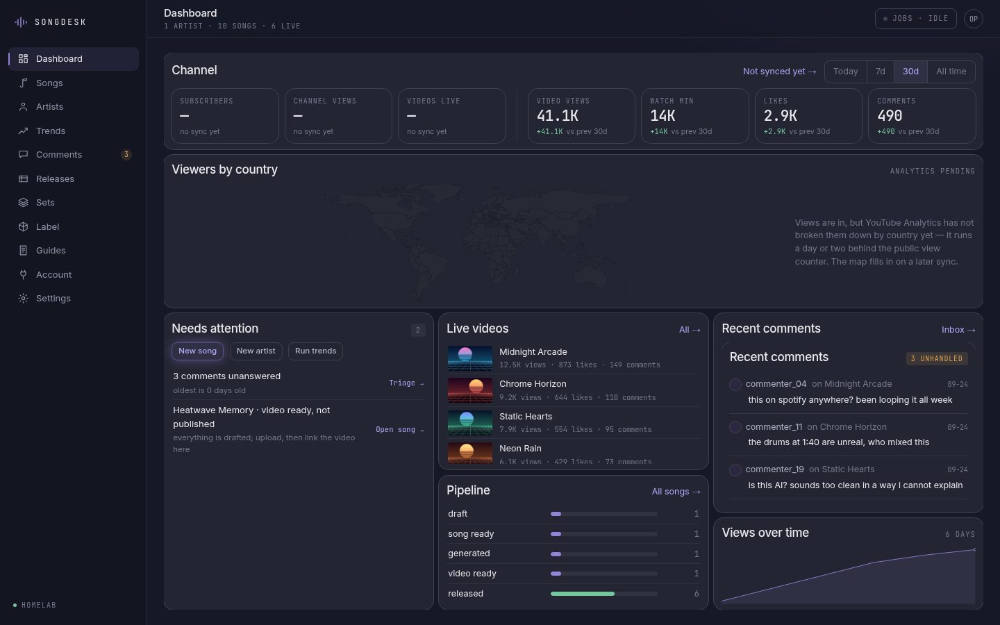
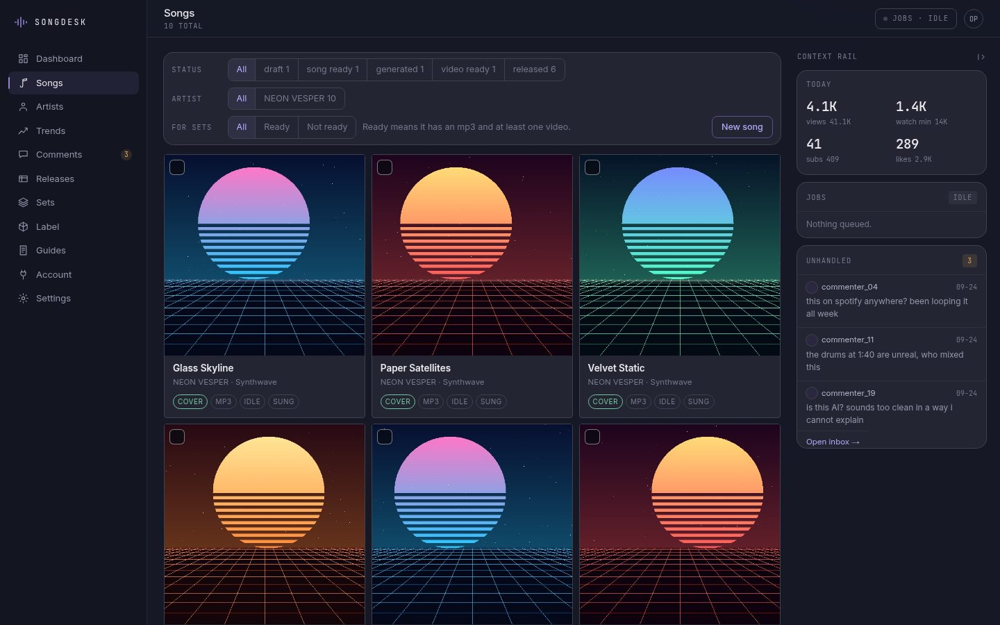
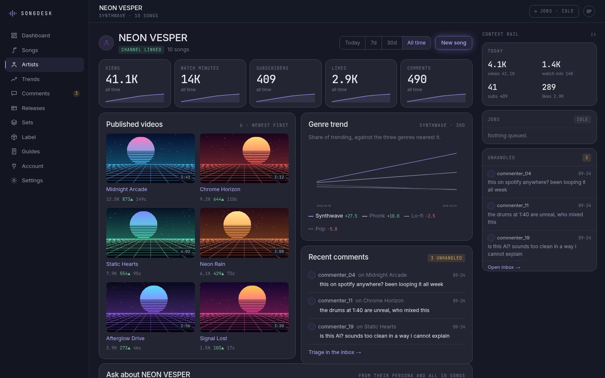
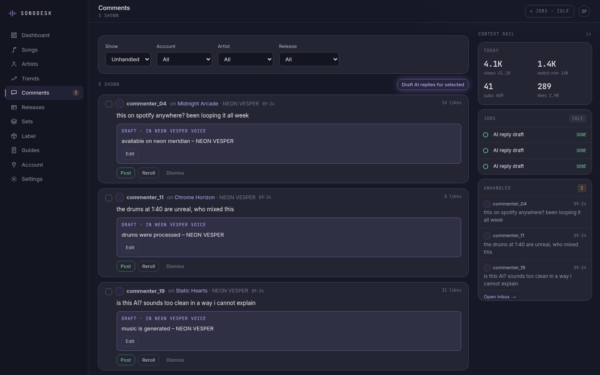
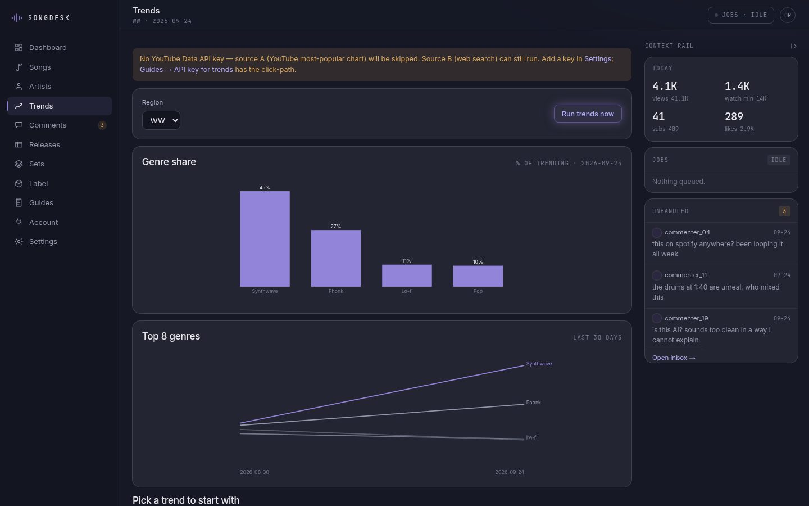

# SongDesk

**A single-user control room for an AI music label.** SongDesk takes a creator from trend data to a finished song package, its video and its Shorts, keeps a roster of virtual artists across labels and YouTube channels, tracks every release, and pulls channel metrics and comments back in.

It is a server-rendered web app that runs on a home server and is used from any device on the local network. Every AI step runs as a background job, so you can start a generation, move on, and find the result waiting when you come back.



> Screenshots show a demo instance with sample data.

| Songs | Artist |
|---|---|
|  |  |
| **Comments** | **Trends** |
|  |  |

## Features

- **Guided creation flow.** Trend or genre, then an artist (the AI proposes three, you pick one), then a concept (three options), then the song package, the video direction and the YouTube metadata. Each step's output is an editable form with *Regenerate* and *Save*, and the next step uses the saved version.
- **Sondo handoff.** Lyrics come with section tags and a style prompt ready to paste into Sondo. The Sondo link and plan are stored with the song as the record of commercial rights, and the exported track is uploaded back for the video and set steps.
- **Artist roster.** Artists keep their appearance, style, genre, vocal style, reply voice, image prompts and uploaded images, and are reused on new songs. Labels, channels and artists are linked many-to-many, so an artist can later move to its own channel.
- **Artist chat.** Ask questions about an artist and get answers drawn from that artist's own stored data, such as why their songs keep returning to the same themes.
- **Labels and branding.** Labels can be generated last from existing artists. Branding prompts for channel icons, banners and covers.
- **Video direction.** A library of genre-neutral style axes that keep the performance and narrative parts of a music video visually distinct, written into a single prompt sized for the target video generator's character limit.
- **Release tracking.** Each song moves through a lifecycle, with a release record per platform. A release cannot be marked *published* without an AI disclosure. CSV export.
- **YouTube metrics and comments.** Per-channel OAuth, scheduled sync of views, likes, watch time and subscribers, KPI tiles with signed deltas for a chosen range, a viewers-by-country map drawn as inline SVG, Shorts against long-form, and a before-and-after comparison around any day, for example the day Shorts started linking to the full song.
- **Comment inbox.** Reply by hand, or have the AI draft a reply in the artist's persona for you to approve before posting.
- **Trend analysis.** A daily job reads YouTube's public most-popular music charts across a configurable set of regions and classifies them by genre, plus a separate web-search pass for context.
- **Channel setup guides.** Tick-off checklists for creating a channel, branding, publishing, monetisation and distribution, tracked per scope and editable as plain Markdown.
- **Long-form sets.** Compile many songs into one continuous 1-hour or 2–3-hour video. The AI proposes a running order you can rearrange. The app shows exactly which track is still missing audio or a motion loop, adds chapter timestamps taken from the rendered file, and builds a thumbnail as a collage of the set's covers.
- **Motion loops and sung videos.** A song's cover becomes a short looping animation of the artist's face via ComfyUI, or a full-length video with the mouth driven by the song's isolated vocal track.
- **Shorts.** A vertical clip of the song's hook: 9:16 artwork composed from the cover, animated to the vocal, with lyrics captions timed by Whisper. Captions can be shifted and re-burned in seconds without touching the GPU. Each Short gets its own listing, a shorter AI disclosure, a pinned first comment and a search call-to-action that leads to the full song.
- **Music videos (in testing).** The scene plan becomes keyframes placed on the song's timeline. Each keyframe can be edited and remade on its own, then animated into short clips that are joined and cut to the song. Generation can be queued for many songs at once.
- **Hook finder.** Finds where the chorus is sung in the audio, by matching the lyric sections to the phrases in the isolated vocal track. Shorts are cut from it.
- **Swappable text backend.** Claude Code CLI, a local Ollama server or any OpenAI-compatible endpoint, chosen at runtime from the settings page. Every call is logged.

## Tech stack

Python · FastAPI · Uvicorn · Jinja2 · SQLite · vanilla JS · Claude Code CLI · Ollama · OpenAI-compatible APIs · YouTube Data and Analytics APIs · ComfyUI (AdvancedLivePortrait, Flux 2 Klein, Wan 2.2) · Mel-Band RoFormer · Whisper · ffmpeg · NumPy · Pillow · systemd

## How it works

One FastAPI process with one SQLite file serves every page and holds all state. AI calls run as fire-and-forget asyncio tasks tracked in a jobs table. A sidebar tray shows what is running across the app, and each page reloads itself when its own job finishes. The Claude backend runs `claude -p` in an empty temporary directory with no tools. Only the trend web-search step is allowed to search, and comment text, which is untrusted input, never reaches a call that has tools.

Scheduled work (channel sync every hour, trends daily) runs as a CLI entry point driven by systemd timers.

Set rendering happens outside the web process:

```
SongDesk ── queued set ──▶ render worker (any host with ffmpeg)
   ▲                         claims a lease, pulls assets over HTTP,
   └── file + checksum ───── encodes, reports progress, posts result back
```

The worker shares no filesystem with the app. A worker that dies mid-render leaves an expired lease, and the job goes back in the queue. Motion loops are sent to ComfyUI, which manages its own queue while SongDesk polls for the result.

## From idea to upload: what is automated

The AI drafts every step and the creator chooses and reviews. The steps with no usable public API stay fully manual:

| Step | Who does it |
|---|---|
| Genre, artist, concept | AI proposes options, the creator picks one |
| Lyrics, style prompt, title | AI drafts, the creator edits |
| Song audio | **Manual in Sondo:** paste, generate, choose a take, download, upload back |
| Cover loop or sung video | Generated locally on ComfyUI |
| Short | Cut from the hook and captioned automatically; the creator checks the timing and the listing |
| YouTube title, description, tags | AI drafts with the AI-disclosure line, the creator reviews |
| YouTube uploads | **Manual in YouTube Studio:** the video and the Short, each with its listing and AI disclosure, the pinned comment, and the Short's related-video link to the full song. Then the links are pasted back |
| Stats and comments | Synced every hour; AI drafts replies in the artist's voice, the creator approves each one |

Long-form sets follow the same pattern: the AI proposes the running order and writes the set metadata, a render worker builds the video, and the upload is manual. Direct YouTube upload is planned.

## Design principles

- **The model writes prose, the code supplies facts.** Chapter timestamps come from the rendered file and are never generated.
- **No build step, no CDN.** Vanilla JS, self-hosted fonts and server-rendered charts, so a page load never needs the internet.
- **The accent colour means AI.** In the dark "Nocturne" interface, only buttons that trigger a model call are tinted, because those calls take from 20 seconds to a few minutes.
- **Nothing blocks.** Long calls are background jobs you can cancel, and a two-hour render is a leased job, not a status flag.

## Availability

The source code is not public. SongDesk is available for licensing, custom deployment or white-label adaptation. Get in touch via [munda.si](https://www.munda.si/#contact).

## License

Proprietary. © 2026 MUNDA PLUS d.o.o. All rights reserved. See [LICENSE](LICENSE).

## Author

Built by [Marko Munda](https://www.munda.si/) · [Munda Plus](https://github.com/MundaPlus)
